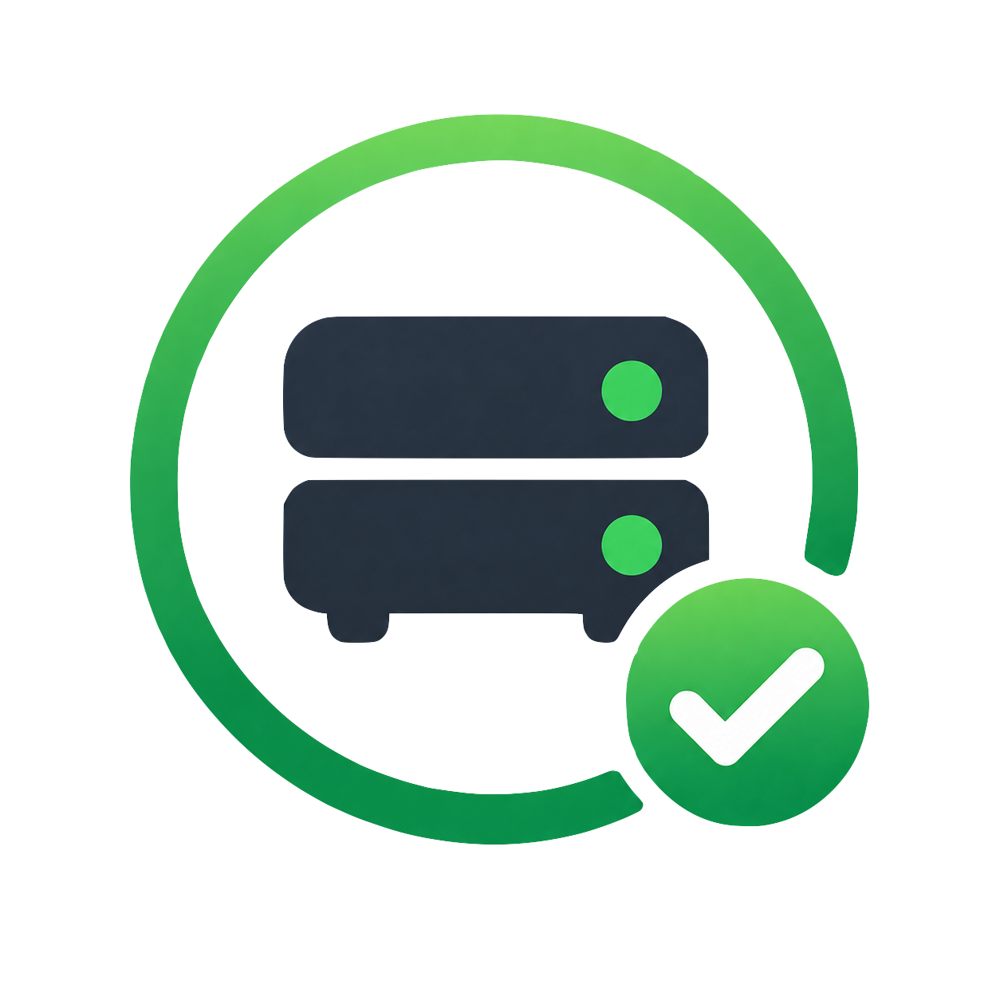

<a name="readme-top"></a>

<!-- PROJECT LOGO -->
<br />
<div align="center">
  
  <h3 align="center">Pi Watchdog - a service availability monitor</h3>
  <p align="center">
    Monitor devices and websites, keep a local history, and receive alerts when their status changes.
    <br />
  </p>
</div>

<!-- TABLE OF CONTENTS -->
<details>
  <summary>Table of Contents</summary>
  <ol>
    <li><a href="#about-the-project">About The Project</a>
      <ul><li><a href="#built-with">Built With</a></li></ul>
    </li>
    <li><a href="#getting-started">Getting Started</a>
      <ul>
        <li><a href="#prerequisites">Prerequisites</a></li>
        <li><a href="#installation">Installation</a></li>
      </ul>
    </li>
    <li><a href="#usage">Usage</a></li>
    <li><a href="#known-issues">Known Issues</a></li>
    <li><a href="#contributing">Contributing</a></li>
    <li><a href="#license">License</a></li>
    <li><a href="#contact">Contact</a></li>
    <li><a href="#acknowledgments">Acknowledgments</a></li>
  </ol>
</details>

<!-- ABOUT THE PROJECT -->

## About The Project

Pi Watchdog is a lightweight PHP service monitor suitable for running on a Raspberry Pi or another Linux host. It checks devices using ping and websites using HTTP, recording each result in a local SQLite database.

The administration page lets you add, edit, enable, disable, and delete monitors. Optional Pushover notifications report failures and recoveries when an established status changes. The first result establishes a baseline without sending an alert.

Read more about the project [here](https://www.spokenlikeageek.com/2026/11/10/pi-watchdog-services-watcher-running-on-a-raspberry-pi-1/).


<p align="right">(<a href="#readme-top">back to top</a>)</p>

### Built With

- [PHP](https://www.php.net/)
- [SQLite](https://www.sqlite.org/)
- [cURL](https://curl.se/)
- [Pushover](https://pushover.net/)
- HTML and CSS

<p align="right">(<a href="#readme-top">back to top</a>)</p>

<!-- GETTING STARTED -->

## Getting Started

Copy the project to your host, initialise the database, configure optional notifications, and schedule the check runner. There are no Composer dependencies.

### Prerequisites

- PHP 8.1 or later, with PDO SQLite, cURL, and session support available to the relevant CLI and web installations.
- A Linux host with the `ping` command and PHP's `exec()` function enabled for ping checks.
- The `sqlite3` command-line tool for the database setup below.
- Cron or another scheduler to run checks automatically.
- A PHP-capable web server for the administration page.
- A Pushover application token and user key if you want push notifications.

### Installation

1. Download or copy the project into a directory such as `/opt/pi-watchdog`, then open that directory:

   ```sh
   cd /opt/pi-watchdog
   ```

2. For a fresh installation, create the database tables:

   ```sh
   sqlite3 watchdog.db < schema.sql
   ```

   A `watchdog.db` file may already be present in your copy. It can contain existing monitors and history; back it up before making changes. The schema uses `IF NOT EXISTS` and does not clear existing data.

3. Edit `config.php` to set your notification details. The expected structure is:

   ```php
   <?php
   return [
       'pushover' => [
           'token' => 'YOUR_APPLICATION_TOKEN',
           'user' => 'YOUR_USER_KEY',
           'priority' => 1,
       ],
   ];
   ```

   Leave `token` and `user` empty to run without notifications. Keep real credentials private.

4. Give the web server and scheduler users read/write access to `watchdog.db` and write access to its containing directory so SQLite can create journal files. Set ownership and permissions for your installation rather than making the directory world-writable.

5. Set your web server's document root to the project's `public` directory. Keep `config.php`, `watchdog.db`, and logs outside the document root. Restrict access to the administration page using your web server or a trusted private network; the application has no built-in login.

   For a local preview, run:

   ```sh
   php -S 127.0.0.1:8080 -t public
   ```

   Open [the administration page](http://127.0.0.1:8080/admin.php). This preview server is for development use.

6. Add your monitors through `admin.php`, then run a check manually:

   ```sh
   php check.php
   ```

7. Use `crontab -e` to schedule checks. For example, this runs every five minutes:

   ```cron
   */5 * * * * /usr/bin/php /opt/pi-watchdog/check.php >> /opt/pi-watchdog/cron.log 2>&1
   ```

   Adjust both absolute paths for your installation. Allow enough time for each run to finish before the next starts, and arrange log rotation if logging is enabled.

<p align="right">(<a href="#readme-top">back to top</a>)</p>

<!-- USAGE EXAMPLES -->

## Usage

Open `admin.php` to manage monitors. Enter a descriptive name, choose a check type, provide a target, and leave the monitor enabled to include it in scheduled checks.

| Check type | Target example         | Successful result                                                                       |
| ---------- | ---------------------- | --------------------------------------------------------------------------------------- |
| HTTP       | `https://example.com/` | HTTP status 200–399 with no cURL error. Redirects are accepted but are not followed.    |
| Ping       | `192.168.1.1`          | One ping completes with exit code zero. The administration form requires an IP address. |

Each run of `check.php` checks enabled monitors sequentially, prints their status, and stores the status, response time in seconds, HTTP code where applicable, and any error. Result timestamps are stored in UTC.

Disabling a monitor stops future checks while preserving its history. Deleting a monitor also deletes all its results.

Pushover alerts are sent when a monitor changes from up to down or from down to up. Repeated results with the same status do not trigger further alerts. Failed notification attempts are reported in the runner output and are not automatically retried.

The main files are:

| File                        | Purpose                                                           |
| --------------------------- | ----------------------------------------------------------------- |
| `check.php`                 | Run enabled checks, store results, and send status-change alerts. |
| `config.php`                | Configure Pushover credentials and priority.                      |
| `schema.sql`                | Create the monitor and result tables and history index.           |
| `watchdog.db`               | Store monitors and check history locally.                         |
| `public/admin.php`          | Manage monitors through a browser.                                |
| `tests/service-history.php` | Test the service history page using a temporary database.         |

<p align="right">(<a href="#readme-top">back to top</a>)</p>

<!-- KNOWN ISSUES -->

## Known Issues

- There is no built-in authentication for the administration page.
- Results are retained indefinitely; no automatic history cleanup is implemented.
- The ping command uses Linux-style options (`ping -c 1 -W 3`). Other operating systems may interpret these options differently.

<p align="right">(<a href="#readme-top">back to top</a>)</p>

<!-- CONTRIBUTING -->

## Contributing

Suggestions, bug reports, and improvements are welcome. When contributing through a hosted repository:

1. Fork the project.
2. Create your feature branch (`git checkout -b feature/AmazingFeature`).
3. Commit your changes (`git commit -m 'Add some AmazingFeature'`).
4. Push to the branch (`git push origin feature/AmazingFeature`).
5. Open a pull request describing the change and how you verified it.

Do not include real Pushover credentials, private monitoring data, database files, or logs in contributions.

<p align="right">(<a href="#readme-top">back to top</a>)</p>

<!-- LICENSE -->

## License

Distributed under the GNU General Public License v3.0. See `LICENSE` for more information.

<p align="right">(<a href="#readme-top">back to top</a>)</p>

<!-- CONTACT -->

## Contact

X - [@spokenlikeageek](https://x.com/spokenlikeageek)

Bluesky - [@spokenlikeageek.com](https://bsky.app/profile/spokenlikeageek.com)

Mastodon - [@spokenlikeageek](https://techhub.social/@spokenlikeageek)

Website - [https://spokenlikeageek.com](https://www.spokenlikeageek.com/tag/pi-watchdog/)

Project link - [Github](https://github.com/williamsdb/pi-watchdog)

<p align="right">(<a href="#readme-top">back to top</a>)</p>

<!-- ACKNOWLEDGMENTS -->

## Acknowledgments

- [Pushover](https://pushover.net/) for push notifications.

<p align="right">(<a href="#readme-top">back to top</a>)</p>
